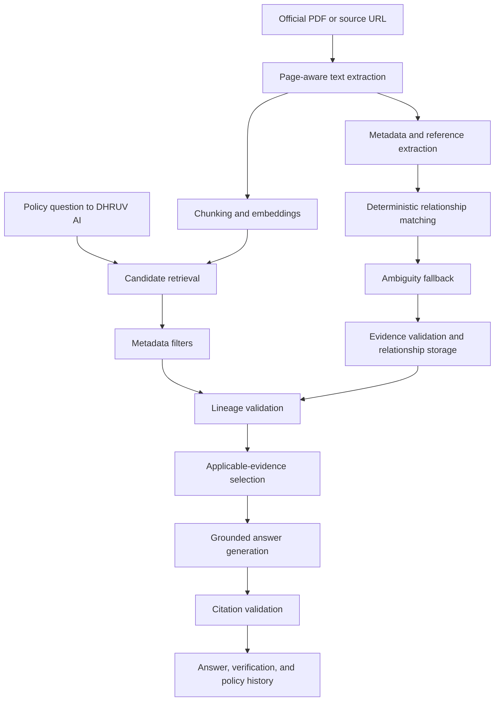
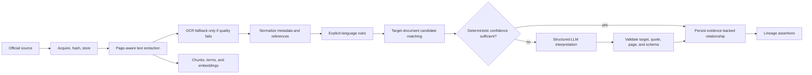

# MeraHaq AI — Project Architecture

## 1. Architecture principle

**MeraHaq AI** is the supersession-aware government policy information platform. **DHRUV AI** is its assistant and RAG intelligence layer, with two deliberately separate stages: **candidate retrieval** and **current-applicability validation**. A document cannot support a current-answer claim merely because it is semantically similar to the question.



## 2. Portability boundary

Core domain logic is ordinary TypeScript in this repository: text normalization, reference parsing, relationship rules, candidate matching, lineage traversal, current-document determination, retrieval scoring, answer orchestration, citation validation, and evaluation. The following are adapter boundaries:

| Adapter      | Managed deployment implementation   | Portable replacement                                |
| ------------ | ----------------------------------- | --------------------------------------------------- |
| Database     | Project relational database adapter | Any MySQL-compatible or PostgreSQL implementation   |
| File storage | Built-in object-storage helper      | S3-compatible client                                |
| Generation   | Server-side model adapter           | OpenAI-compatible or other model client             |
| Embeddings   | OpenAI-compatible embedding adapter | Any provider that returns the configured dimensions |
| Deployment   | Managed application deployment      | Container or Node hosting platform                  |

No core lineage or policy decision may depend on a platform-only API.

## 3. Concrete MVP retrieval decision

The managed project database is MySQL/TiDB-compatible rather than PostgreSQL, so PostgreSQL plus pgvector is not selected for the first implementation. The MVP does **not** introduce a separate vector database. Its corpus is intentionally small enough to use portable relational storage and deterministic application-side scoring.

| Retrieval concern    | MVP decision                                                                                                                                              |
| -------------------- | --------------------------------------------------------------------------------------------------------------------------------------------------------- |
| Embedding protocol   | OpenAI-compatible provider adapter                                                                                                                        |
| Default model        | `text-embedding-3-small`, configured through environment variables                                                                                        |
| Embedding dimensions | 1536                                                                                                                                                      |
| Vector storage       | `document_chunks.embedding_json` as a serialized numeric vector; no file bytes or provider response payloads in the database                              |
| Semantic scoring     | Application-side cosine similarity over metadata-filtered candidates                                                                                      |
| Lexical scoring      | Portable BM25-style score from normalized query terms and persisted chunk-term statistics                                                                 |
| Hybrid ranking       | `0.55 × lexical_score + 0.45 × normalized_cosine_score` before lineage adjustment                                                                         |
| Candidate count      | Keep the top 20 hybrid candidates before eligibility selection                                                                                            |
| Chunking             | Paragraph-aware, page-aware chunks of approximately 550 tokens with 80-token overlap; never cross a source-page boundary without recording the page range |
| Metadata filtering   | Scheme, issuing authority, document type, issue/effective date, source status, and question intent                                                        |
| Reranking            | Deterministic lineage and evidence score, not an LLM reranker in the MVP                                                                                  |
| Current-answer rule  | Prefer `CURRENT_VERIFIED`; return `AMBIGUOUS` separately with warning; exclude superseded/revoked evidence unless the user asks for history               |

This design is testable and portable for the curated corpus. If scale demands indexed vector search later, `EmbeddingProvider` and `Retriever` interfaces can be implemented with PostgreSQL plus pgvector without changing the source, lineage, evidence, or answer contracts.

## 4. Hybrid retrieval and lineage adjustment

```text
hybrid_score = 0.55 × lexical_score + 0.45 × semantic_score
final_score  = hybrid_score + lineage_adjustment + evidence_adjustment
```

`lineage_adjustment` boosts verified current documents, leaves ambiguous candidates available only with warnings, and suppresses documents that are superseded, replaced, or revoked for the requested scope. Historical documents can be selected only for questions about history, changes, or former rules.

## 5. Relational model

| Table                    | Role                                                                                    |
| ------------------------ | --------------------------------------------------------------------------------------- |
| `schemes`                | Supported policy or scheme groups and coverage statement                                |
| `documents`              | Official-document identity, authority, source URL, storage key, hash, dates, and status |
| `document_references`    | Raw document numbers, dates, quoted language, and candidate-resolution state            |
| `document_relationships` | Directed lineage edges with allowed relationship labels and verification state          |
| `relationship_evidence`  | Exact evidence quote, page/location, extraction method, and confidence                  |
| `document_chunks`        | Page-aware text chunks, serialized embedding, and retrieval metadata                    |
| `chunk_terms`            | Normalized lexical term statistics for portable BM25-style scoring                      |
| `lineage_assertions`     | Computed current/historical/ambiguous status with an explainable basis                  |
| `evaluation_cases`       | Gold questions and expected current documents, relationships, and citations             |
| `evaluation_runs`        | Reproducible baseline and DHRUV AI assistant outcomes and metrics                       |

Object storage holds original PDFs and derived artifacts. The database stores only storage keys, source URLs, metadata, and hashes.

## 6. Ingestion and relationship pipeline



Deterministic rules classify explicit wording such as “supersedes,” “amends,” “corrigendum,” “in partial modification of,” “replaces,” “revokes,” “extends,” and “continues.” An LLM is a constrained fallback for ambiguous scope or language. Its output is invalid unless the target document exists and the evidence quote appears in the stored page-aware text.

## 7. Answer and citation contract

The answer service returns structured data, not a raw model response:

```text
answer_markdown
verification_state
valid_as_of
selected_document_ids
citations[{document_id, page_start, page_end, quote, source_url}]
warnings[]
lineage_summary
trace_id
```

The backend validates each citation against indexed source text before it can appear in the UI. The answer generator is instructed to abstain when selected evidence is insufficient.

## 8. API boundaries

| API group    | Purpose                                                       |
| ------------ | ------------------------------------------------------------- |
| `schemes`    | List supported schemes and retrieve coverage details          |
| `documents`  | Retrieve document metadata, sources, and page-aware evidence  |
| `lineage`    | Return graph, timeline, current candidates, and edge evidence |
| `qa`         | Run baseline or lineage-aware answer orchestration            |
| `ingestion`  | Future protected document upload and processing operations    |
| `evaluation` | Run curated cases and retrieve reproducible metrics           |

## 9. Delivery sequence

MeraHaq AI presents the platform experience and its verified policy corpus. DHRUV AI handles the assistant journey, including question understanding, retrieval, lineage-aware selection, grounded answer generation, citation validation, and uncertainty communication. The existing implementation preserves this separation while keeping the source, lineage, and evidence safeguards unchanged.
