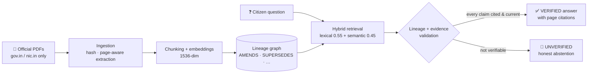

<div align="center">

# 🇮🇳 MeraHaq AI

### *Mera Haq* — "my right" — answered only from official sources, only when they're still current.

**A supersession-aware government policy platform with DHRUV, an evidence-first AI assistant.**

[](https://www.typescriptlang.org/)
[](https://react.dev/)
[](https://expressjs.com/)
[](https://trpc.io/)
[](https://tidbcloud.com/)
[](https://openrouter.ai/)
[](https://vercel.com/)
[](./server/dhruv)
[](#-the-corpus-live--verified)

</div>

---

## 🚨 The problem this solves

Government schemes change by amendment. A guideline from 2019 may be **amended in 2021, partially superseded in 2023** — and a normal RAG system will happily summarise the old PDF, because the old PDF is what it retrieved.

> A stale document, faithfully summarised, is **fully grounded — and fully wrong**.

MeraHaq AI treats *semantic relevance* as a hint, never as proof. Before DHRUV answers, it validates **where each document sits in its amendment lineage** and **whether every claim is actually supported by a cited page**. If it can't verify, it says so — plainly, with no citations, instead of guessing.

---

## ✨ What DHRUV does differently

| | Ordinary policy chatbot | **DHRUV in MeraHaq AI** |
|---|---|---|
| Source of truth | Whatever the retriever found | A **typed lineage graph** of official documents |
| Amendments | Invisible | First-class edges — `AMENDS`, verified against the documents themselves |
| Citations | Decorative links | **Per-claim validation** — unsupported claims are rejected |
| Stale rules | Answered confidently | Blocked: **stale-answer rate = 0% is a release criterion** |
| Doesn't know | Hallucinates politely | **Abstains** with an explicit `UNVERIFIED` state |

### Typed answer states

Every answer carries exactly one state — the UI shows it, the API returns it:

| State | Meaning |
|---|---|
| ✅ `VERIFIED` | Every claim is backed by a validated citation from a currently-in-force document |
| ⚠️ `AMBIGUOUS` | Evidence exists but lineage or support is contested — answer comes with a caution |
| 🛑 `UNVERIFIED` | Not enough verified evidence — DHRUV abstains instead of answering |
| ⛔ `REJECTED` | Internal: candidate answers that failed citation/evidence validation and were never shown |

---

## 📚 The corpus (live & verified)

Three scheme families, ingested through the real pipeline — official PDF → hash → page-aware extraction → chunking → embeddings → lineage detection:

| Scheme family | Documents | Pages | Lineage |
|---|---|---:|---|
| Jal Jeevan Mission — Key Resource Centres | Guideline + Amendment | 41 + 44 | `AMENDS` ✅ VERIFIED (0.97) |
| PM-KISAN | Operational Guidelines + Para 8.1 Amendment | 10 + 1 | `AMENDS` ✅ VERIFIED (0.97) |
| National Livestock Mission | Operational Guidelines | 68 | CURRENT_VERIFIED |

**329 chunks · 100% embedded (1536-dim) · all 5 documents `CURRENT_VERIFIED`**

> Only official `gov.in` / `nic.in` sources are ingested. The one known gap — the 2022 NLM amendment order, which today survives only on a non-gov.in portal as a scanned PDF — is deliberately left out rather than quietly lowering the bar.

### It actually works — two live checks

**Q:** *How much income support does a PM-KISAN farmer family receive per year, and in how many installments?*
→ ✅ **VERIFIED** — *"Rs. 6,000 per year, paid in three equal installments (every four months)"* — citations to the official guidelines.

**Q:** *What premium do farmers pay under PMFBY?* (a real scheme — but **not in the corpus**, and the model "knows" it from training)
→ 🛑 **UNVERIFIED** — abstains, zero citations. Knowing isn't evidence.

---

## 🏗️ How it works



1. **Ingestion** — guarded official-PDF pipeline; content is hashed, extracted page-by-page, and stored with its official source URL.
2. **Lineage** — documents are linked by typed relationships; a document's *current* status is asserted from the graph, never assumed from its date.
3. **Retrieval** — hybrid lexical + semantic ranking over embedded chunks.
4. **Validation** — lineage status and per-claim citation/evidence checks gate the answer. Fail either, and the answer state says so.

---

## 🛠️ Tech stack

| Layer | Tech |
|---|---|
| Frontend | React 19 · Vite · Tailwind CSS · shadcn/ui |
| API | Express · tRPC · Zod |
| Domain core | `server/dhruv/` — ingestion, lineage, retrieval, answering, citation & evidence validation, evaluation |
| Data | Drizzle ORM · TiDB Cloud (MySQL-compatible) in production · MariaDB locally |
| AI | Any OpenAI-compatible provider via env config — OpenRouter by default (`gpt-5-mini` + `text-embedding-3-small`) |
| Deploy | Vercel (frontend + serverless API) — see [`DEPLOY-VERCEL.md`](./DEPLOY-VERCEL.md) |

---

## 🚀 Run it locally

```bash
pnpm install
cp .env.example .env        # fill in DATABASE_URL, JWT_SECRET, LLM_API_KEY
```

Rebuild the full local corpus (MariaDB + migrations + seed + lineage graph) in one shot:

```bash
bash scripts/restore-local-db.sh
```

Then:

```bash
pnpm dev        # develop
pnpm test       # 21 tests — ingestion, answering, lineage rules, evaluation
pnpm check      # typecheck
pnpm build      # production build
```

Inspect the corpus lineage graph any time:

```bash
pnpm exec tsx scripts/graph-dump.ts
```

---

## ☁️ Deployment

Production runs on **Vercel + TiDB Cloud Serverless** — full step-by-step in [`DEPLOY-VERCEL.md`](./DEPLOY-VERCEL.md).

| Variable | Purpose |
|---|---|
| `DATABASE_URL` | TiDB connection string (with TLS parameters) |
| `JWT_SECRET` | Session cookie signing secret |
| `LLM_API_KEY` | OpenRouter (or any OpenAI-compatible) key |
| `STORAGE_DIR` | `/tmp/storage` on Vercel |

**Known limits, stated honestly:** on serverless, `/storage/*` downloads of source PDFs 404 (ephemeral filesystem) — citations link to the official originals, and answers are unaffected. Admin ingestion still uses the legacy OAuth login; replacing it and adding object storage are roadmap items, not hidden gaps.

---

## 📂 Repository map

| Path | What lives there |
|---|---|
| `server/dhruv/` | The intelligence layer — ingestion, lineage, retrieval, answering, validation, evaluation |
| `client/src/` | React app — question composer, answer cards with trust indicators, lineage & timeline previews |
| `drizzle/` | Schema + migrations |
| `scripts/` | Corpus seed, embedding backfill, lineage graph dump, local DB restore |
| `api/index.ts` | Vercel serverless entry (shares the `createApp()` factory with the standalone server) |
| `PROJECT_CONTEXT.md` | Product purpose, scope, terminology |
| `MERAHAQ_RULES.md` | The non-negotiable evidence & safety rules |
| `PROJECT_ARCHITECTURE.md` | Architecture and retrieval design |
| `DECISIONS.md` | Architectural decisions, in the open |
| `RESEARCH_LOG.md` · `VALIDATION_NOTES.md` | Research findings and validation records |

---

## 🧭 Design principles

- **Evidence over fluency.** A confident wrong answer about a citizen's entitlement is worse than no answer.
- **Abstention is a feature.** `UNVERIFIED` is a successful outcome when the corpus can't support a claim.
- **Official sources only.** No blogs, no summaries-of-summaries, no scraped FAQs as ground truth.
- **Show the uncertainty.** Coverage, lineage status, and answer state are always visible — never buried.
- **No fake numbers.** Every statistic in this README is measured from the running system.

---

## 🗺️ Roadmap

- [x] De-platformed core — runs fully outside the original managed platform (env-configured LLM & storage)
- [x] First real corpus with verified amendment lineages (JJM, PM-KISAN, NLM)
- [x] Cloud database seeded & answer-verified (TiDB)
- [ ] Object-storage swap so source-PDF downloads survive serverless
- [ ] Self-hosted admin authentication for ingestion
- [ ] Decision on the NLM amendment's non-gov.in source (see corpus note above)
- [ ] Grow the corpus family by family — PMFBY and e-NAM are candidate chains, added only when their lineages verify

---

<div align="center">

Built for **Smart India Hackathon** · MeraHaq AI + DHRUV

*Because a citizen asking about their haq deserves the current rule — cited, or not claimed at all.*

</div>
